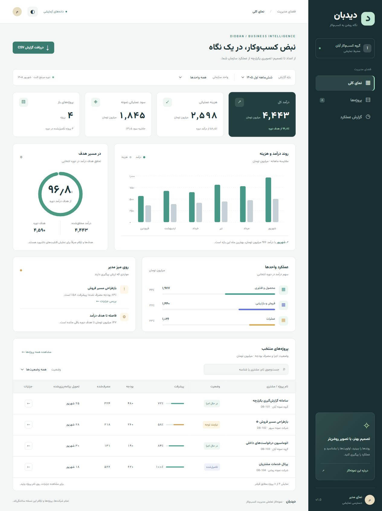

# دیدبان؛ داشبورد مدیریتی فارسی

**نمونه‌کار مستقل و تعاملی برای تبدیل داده‌های پراکنده به یک نمای مدیریتی روشن.**

[مشاهده دموی آنلاین](https://s8700174-code.github.io/didban-dashboard/) · [English](README.md) · [سناریوی معرفی](docs/DEMO.md)



## مسئله‌ای که این نمونه نشان می‌دهد

مدیر برای بررسی درآمد، هزینه، اهداف و وضعیت پروژه‌ها به یک نمای هماهنگ نیاز دارد. دیدبان این اطلاعات را با فیلتر دوره و واحد، نمودارهای خوانا و جزئیات قابل بررسی در یک محیط فارسی جمع می‌کند.

## امکانات پیاده‌سازی‌شده

- شاخص‌های محاسبه‌شده درآمد، هزینه، سود نمونه، تحقق هدف و پروژه‌های باز
- فیلتر دوره و واحد سازمانی که هم‌زمان بر نمودارها، جدول‌ها و گزارش اثر می‌گذارد
- نمایش سهم واحدها، مقایسه ماهانه و هشدار مصرف بودجه پروژه
- فهرست پروژه‌ها با جست‌وجو، وضعیت، پیشرفت، بودجه و جزئیات مراحل تحویل
- نگهداری محلی پروژه‌های مورد پیگیری و انتخاب حالت روشن یا تیره
- خروجی CSV فارسی مطابق فیلتر جاری و گزارش ماهانه قابل چاپ
- چیدمان راست‌به‌چپ، قلم فارسی محلی، طراحی موبایل و کنترل‌های قابل استفاده با صفحه‌کلید

## امتحان کنید

۱. دوره را روی «شهریور ۱۴۰۵» و واحد را روی «فروش و بازاریابی» بگذارید؛ درآمد باید **۳۱۱**، هزینه **۱۶۶** و سود نمونه **۱۴۵ میلیون تومان** باشد.

۲. پروژه «بازطراحی مسیر فروش» را باز کنید؛ مصرف ۲۱۸ از ۲۶۰ میلیون تومان در کنار پیشرفت ۵۸٪ نمایش داده می‌شود.

۳. به «گزارش عملکرد» بروید و ارقام همان دوره را با خروجی CSV مقایسه کنید.

## اجرا و بررسی

با Node.js نسخه ۲۰ یا بالاتر:

```bash
npm start
npm run check
npm test
```

نشانی محلی: `http://127.0.0.1:4173`. نیازی به نصب وابستگی نیست.

## حدود نمونه

تمام داده‌ها و نام شرکت‌ها ساختگی‌اند. این پروژه **سابقه سفارش مشتری نیست** و اتصال به پایگاه داده، احراز هویت، مجوزهای کاربران و ثبت ممیزی سمت سرور ندارد. ذخیره پیگیری و رنگ فقط در مرورگر انجام می‌شود. دوره‌ها ثابت و نمایشی‌اند. سود نمونه صرفاً درآمد منهای هزینه است؛ مالیات، تأمین مالی و استهلاک مدل نشده‌اند. بودجه پروژه‌ها مستقل از گردش مالی ماهانه است. فیلتر دوره پروژه به ماه گزارش‌دهی آن مربوط است، نه تاریخ تحویل نمایش‌داده‌شده.

برای تبدیل این نمونه به سامانه واقعی، منابع داده، نقش کاربران، الزامات امنیت و گزارش، زیرساخت و معیارهای پذیرش باید جداگانه تعیین شوند.

## گفتگو درباره همکاری

[پروفایل پونیشا](https://ponisha.ir/profile/sabaghi_ir)

قلم Vazirmatn با مجوز SIL OFL و متن مجوز در `assets/OFL.txt` استفاده شده است. این نسخه برای کد برنامه مجوز استفاده مجدد عمومی اعطا نمی‌کند؛ شرایط استفاده را با صاحب مخزن هماهنگ کنید.
