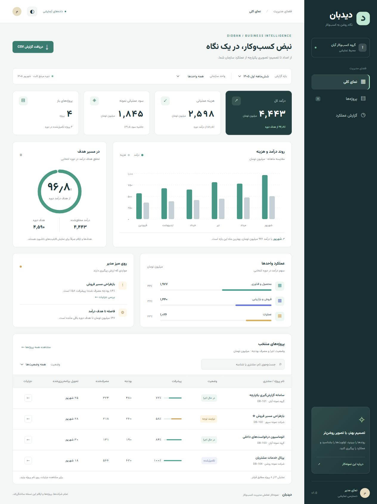

# دیدبان · Didban

### A clear view of business performance

An interactive Persian / RTL executive dashboard with coordinated financial analytics, project tracking and downloadable reports. Built as an independent portfolio demonstration, with entirely synthetic companies, projects and financial data.

[**Open live demo →**](https://s8700174-code.github.io/didban-dashboard/) · [فارسی](README.fa.md) · [Architecture](docs/ARCHITECTURE.md) · [Demo walkthrough](docs/DEMO.md)



## What you can try

- Switch between six months, summer and September-equivalent **Shahrivar 1405**; filter by business unit.
- Explore revenue, operating costs, illustrative profit, target attainment and open project counts.
- Compare monthly revenue and costs and see each business unit's contribution.
- Search projects by name, client or ID; combine search with status and reporting filters.
- Open project details, review milestone status and bookmark a project locally.
- Export the current financial scope or filtered project list as UTF-8 CSV; print monthly reports.
- Use light/dark appearance, keyboard navigation and responsive mobile layouts.

## Run locally

Requires Node.js 20 or newer. No package installation or build step is needed.

```bash
npm start
# http://127.0.0.1:4173
```

```bash
npm run check
npm test
```

Serve through HTTP rather than opening `index.html` directly, because the application uses native JavaScript modules. Deployment is plain static hosting; GitHub Pages can serve the root of `main` with `.nojekyll`.

## Design and implementation

Vanilla JavaScript ES modules, semantic HTML, CSS custom properties, hand-built SVG charts and a locally bundled Persian font. No chart framework, analytics trackers, CDN dependency or external API calls at runtime. Data selection and financial calculations are separated from DOM rendering and covered by Node's built-in test runner.

The visual language uses deep teal navigation, a restrained emerald accent, clear typographic hierarchy and compact financial reporting. The mobile layout moves navigation to the bottom and keeps wide tables independently scrollable.

## Scope and honesty

This is a **front-end portfolio demo**, not a production finance system or a previously delivered client engagement. It has no server authentication, database, multi-user access control or real-time integrations. The manager avatar is a demo persona, not an authenticated role. Financial periods are fixed sample periods; no live performance claim is made. Browser storage is used only for appearance and project bookmarks.

Illustrative operating profit is revenue minus operating cost; it excludes tax, financing and depreciation. Project budgets are a separate sample dataset and must not be added to monthly financial totals. A project's period filter uses its assigned reporting month, not its displayed delivery date. Persian month names and digits are localized presentation, not a full date-conversion engine.

For a real engagement, scope data sources, identity and permissions, audit requirements, validation rules, infrastructure and acceptance criteria before estimating a production implementation.

## Project structure

```text
index.html           Accessible page structure and dialogs
src/model.js         Synthetic datasets, selectors, KPI calculations and CSV encoding
src/app.js           Rendering, coordinated filters, navigation and interactions
src/styles.css       RTL, responsive, dark and print styles
tests/model.test.js   Reconciliation, filters, boundaries and CSV safety tests
assets/              Local Vazirmatn font and its license
docs/                Architecture, walkthrough and screenshots
server.mjs           Loopback-only local preview server
```

## Collaboration

For project discussions: [Ponisha profile](https://ponisha.ir/profile/sabaghi_ir). This repository demonstrates the implementation above; it does not claim additional certifications, client history or guarantees.

Font: [Vazirmatn v33.003](https://github.com/rastikerdar/vazirmatn), used under the SIL Open Font License, included in `assets/OFL.txt`. No open-source license is granted for the application code in this version; contact the repository owner for reuse terms.
