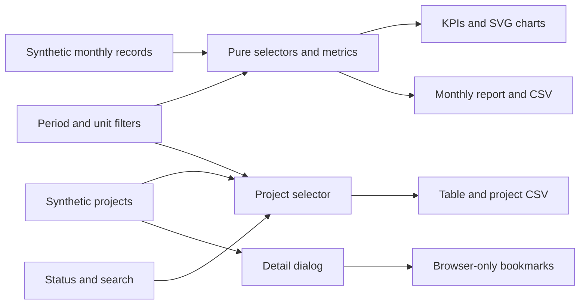

# Architecture and validation

## Data flow

`model.js` is deliberately independent of the browser. All values are expressed in **millions of toman**. Zero-denominator cases return zero, not NaN or Infinity. Rounding happens only in presentation; target attainment uses the unrounded aggregate. The gauge arc caps at 100%, while its numeric label preserves overachievement.

Three units and six sample months form 18 financial records. Eight projects use stable IDs. This small explicit dataset makes the behavior reproducible and easy to inspect. It is not representative of an actual business.

## Accessibility and responsive behavior

Semantic controls, visible focus indicators, labeled selectors, a skip link, native modal dialogs, status announcements and a textual report alternative to SVG charts. On small screens, navigation moves to the bottom and tables scroll within their own containers. No animation is needed to understand the interface.

## Security and privacy boundaries

No secrets, personal customer information, analytics, third-party API calls or remote scripts. Project details render only repository-controlled fixture strings. Search input is used for filtering and is never interpolated into HTML. CSV fields are quoted and spreadsheet-formula prefixes neutralized. If fixtures are replaced with untrusted API data, render through text nodes or an audited sanitization boundary before using this renderer in production.

LocalStorage holds only appearance and project IDs and tolerates blocked storage. No authentication or authorization is simulated. The local preview server listens only on loopback; it is not a production server. GitHub Pages serves static assets only.

## Verification

Automated tests check aggregation reconciliation, time and unit selection, combined project filters, empty metrics, unique IDs, progress bounds and CSV quoting/formula neutralization. Manual browser checks cover navigation, composed filters, details, bookmarks, empty results, theme, CSV download and mobile layout. See `QA.md` for observed results.

## Production extension path

Define a versioned API contract and replace synthetic-data selectors with a data adapter. Add server-side identity, tenant isolation, roles and audit logs; agree accounting definitions and source reconciliation; add database migrations, backups, error handling and end-to-end tests. These are future work, not shipped features.
